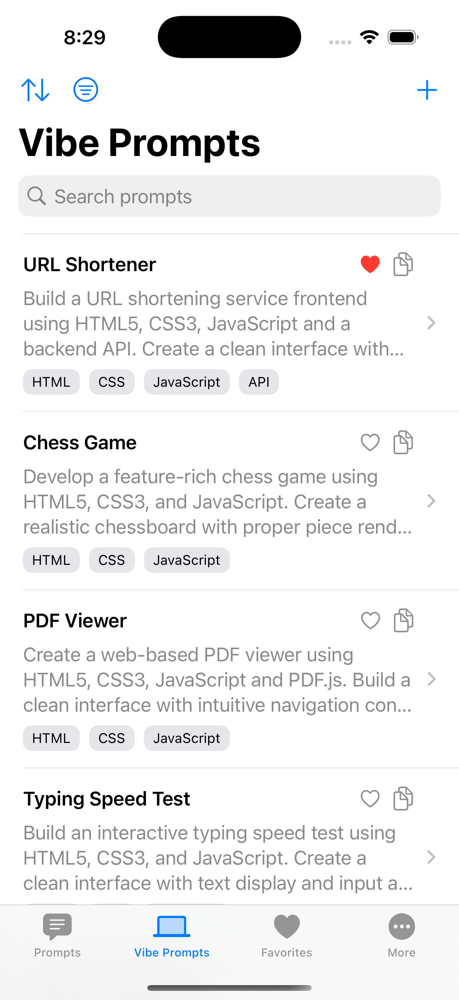
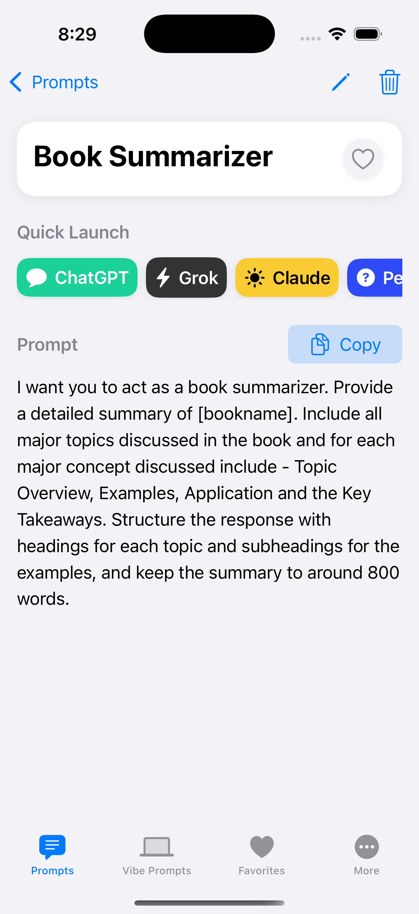
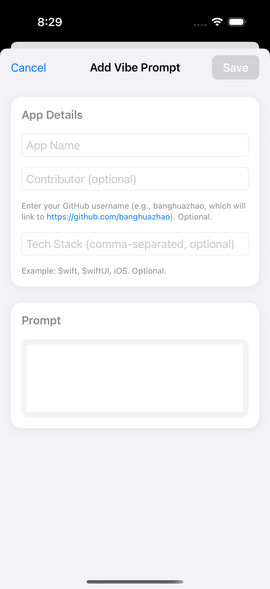

# AI Prompts ✨

A Swift iOS app for managing, browsing, and sharing AI prompts. Inspired by [f/awesome-chatgpt-prompts](https://github.com/f/awesome-chatgpt-prompts), this app offers a curated collection of prompts for ChatGPT, Grok, and other LLM tools. Now featuring prompt categories, context engineering tips, and a built-in prompt analyzer for enhanced prompt engineering.

## 📸 Screenshots

<p align="center">
  
  
  
</p>

## ✨ Features

- 📚 **Curated Prompts**: Browse a collection of high-quality AI prompts, including a special "Vibe Prompts" section for app-specific or mood-based prompts.
- ✨ **Generate Prompt Ideas**: Tell Apple Intelligence what a prompt should help with (or leave it empty for a surprise) and it writes a complete prompt, with a title and fill-in blanks, ready to review and save. Works for Prompts and Vibe Prompts, on device and offline. Devices without Apple Intelligence get an offline remix of the library instead.
- ❤️ **Favorites**: Mark prompts as favorites for quick access.
- 🕘 **Recently Used & Most Used**: Prompts you copy, quick launch or run show up in a **Recently Used** shelf at the top of the Prompts tab, and the **Most Used** sort puts your go-to prompts first. Long-press a card to remove it, or tap **Clear**.
- 👆 **Swipe Actions**: Swipe right on any prompt to favorite it, or left to copy or delete it. **Copy** is also the first item in every long-press menu.
- ↩️ **Undo Delete**: Deleting a prompt (one, several, or from its page) happens right away, with an **Undo** button at the bottom of the screen for a few seconds. Undo brings it back exactly as it was, including favorites, category and usage history.
- 📋 **Add from Clipboard or the Share Sheet**: Choose **Add from Clipboard** (the Prompts tab's **…** menu, or touch and hold **+** in Vibe Prompts), or share text from any app to **AI Prompts**. A short first line becomes the title. Shared prompts are added the next time you open the app.
- 💾 **Backup & Restore**: In **Settings › Backup**, export your prompts, favorites, categories and on-device chats to a JSON file, and restore it on any device. Restoring merges by title and never deletes anything.
- 🆕 **Fresh Prompts Without an Update**: New prompts published to [`content/feed.json`](content/feed.json) reach every install on next launch, marked **NEW** with a "new prompts added" banner. Deleted prompts never come back.
- 📱 **Widgets**: *Prompt of the Day* (Home Screen and Lock Screen) and *Favorite Prompts*. Tap to open the prompt, or tap its copy button to copy it without opening the app.
- 🗣️ **Siri & Shortcuts**: Copy, open, or get a random prompt with App Shortcuts, Siri, and Spotlight. On iOS 26 with Apple Intelligence, the **Run Prompt with Apple Intelligence** action runs a prompt (optionally with your own input) on device and returns the answer, which is also saved to Chats.
- 🔦 **Spotlight**: Every prompt is indexed in Spotlight (iOS 18+). Tapping a result opens it in the app.
- 🎛️ **Control Center**: A **Random Prompt** control (iOS 18+) for Control Center, the Lock Screen and the Action button.
- 🎨 **Image Playground**: Turn image prompts, or any on-device answer, into a picture (iOS 18.1+, Apple Intelligence devices).
- 🖼️ **Share as Image**: Share any prompt or answer as a branded card that links to the App Store.
- 🌏 **Traditional Chinese**: Full zh-Hant localization of the app, widgets, and Siri phrases.
- 🧩 **Fill-in-the-Blank Templates**: Prompts with variables (`{{topic}}`, `${Name: default}`, or a trailing `My first request is "..."`) get a **Customize & Use** sheet. Fill in the blanks, preview the result live, then copy it or launch it straight into ChatGPT, Claude, Gemini, Grok, Perplexity, Copilot, or Le Chat. While you write a prompt, the form lists the blanks it found. Values you type are remembered for the same blank next time; **Settings › Prompt Creation › Forget Filled-In Blanks** clears them.
- 🚀 **Quick Launch**: Launching a prompt into an assistant also copies it, so it's one paste away if the assistant's app opens without it (turn off **Also Copy the Prompt** in **Settings › Quick Launch** to skip that). Pick, hide and reorder assistants there too.
- 🍎 **Run on Device with Apple Intelligence**: On iOS 26 devices with Apple Intelligence, run any prompt right in the app with Apple's on-device Foundation Models: free, private and offline. Replies stream in, you can ask follow-ups, and conversations are saved under **Favorites › Chats**. If the model declines a prompt, the app offers Quick Launch instead. Other devices keep the existing Copy and Quick Launch flow.
- 🔎 **Ask in Plain Language**: In the Search tab, describe what you need (like "help me prepare for a job interview") and Apple Intelligence picks the best prompts from the library. It can only choose prompts that exist.
- 💡 **Blank Ideas**: In **Customize & Use**, tap **Suggest Ideas** for three tappable values for every blank.
- 🏷️ **Auto Title & Category**: When adding a prompt, Apple Intelligence suggests its title, category and developer flag, or the app name and tech stack for a vibe prompt.
- 🌐 **On-Device Translation**: If a prompt isn't in your language, translate it in place with Apple's Translation framework (iOS 18+) and copy the translation.
- 🔍 **Prompt Details**: View detailed information for each prompt, including contributor, tech stack, and its size in words and estimated tokens.
- 🔎 **Smarter Search**: Search matches every word you type, in any order, ignoring case and accents, and also looks at categories, tech stacks and contributors. The best matches (titles that start with or contain your words) come first. Recent searches are suggested in every search field; in the Search tab, swipe one to remove it or tap **Clear**.
- 🎲 **Surprise Me**: In the Prompts tab's **…** menu, open a random prompt from the ones currently listed.
- 🖥️ **Modern SwiftUI Interface**: Clean, tab-based navigation for Prompts, Vibe Prompts, Favorites, and More.
- 💻 **Mac App**: The same app runs natively on Mac (Mac Catalyst, universal purchase) with a sidebar instead of the tab bar and lists kept in a readable column. The Mac app has no ads. Mac App Store listing and screenshots: [`release-assets/1.6.0/mac-store-listing`](release-assets/1.6.0/mac-store-listing).
- 🫧 **Liquid Glass Design**: On iOS 26 the app uses Liquid Glass throughout: a floating tab bar that shrinks while you scroll, a dedicated Search tab that searches prompts and vibe prompts together, and glass buttons, chips, quick launch pills, and cards. iOS 17.4–25 keep the original look.
- 🧩 **Modular Architecture**: Includes a reusable `MoreApps` module for app recommendations, with localization support.
- 💾 **Local Data Management**: Uses GRDB for efficient, local data storage and management.
- 🗂️ **Prompt Categories**: Organize and browse prompts by category for easier discovery and filtering. The category picker shows how many prompts each one holds.
- 🧠 **Context Engineering Tips**: Access best practices and actionable tips for effective context engineering directly in the app, helping you craft better prompts for LLMs.
- 🛠️ **Prompt Engineering Analyzer**: **Check Prompt** gives quick tips on clarity, length, repetition, output format, audience and structure. Length and repetition checks work in any language; word-based tips only appear for English prompts, and match whole words only.
- 🌙 **Appearance**: Follows the system light or dark setting by default, or pick Light or Dark in **Settings › Appearance**.
- 🔠 **Dynamic Type**: Text throughout the app follows your text size setting, including accessibility sizes.
- 📢 **Ad Integration**: Integrates Google Mobile Ads with ATT permission handling (iPhone and iPad only).
- 🛒 **App Store Links**: The More tab features other recommended apps with direct App Store links.

## 🚀 Getting Started

### Prerequisites

- Xcode 27.1 or later for native iPhone Duo layouts (the deployment minimum remains iOS 17.4)
- Swift 5.9+
- iOS 17.4+ (Liquid Glass on iOS 26+)

### Installation

1. Clone the repository:
   ```bash
   git clone https://github.com/banghuazhao/ai-prompts.git
   cd ai-prompts
   ```
2. Open `AIPrompts.xcodeproj` in Xcode.
3. Run the project on your simulator or device.

### 🗂️ Project Structure

- `AIPrompts/App/` – App entry point and main views (tab navigation)
- `AIPrompts/Components/` – SwiftUI components (Favorites, Prompts, VibePrompt, More, etc.)
- `AIPrompts/Model/` – Data models (`Prompt`, `VibePrompt`)
- `AIPrompts/Service/` – Data management, CSV loading, and app services
- `AIPrompts/Modules/MoreApps/` – Modular feature for app recommendations (with localization)
- `AIPrompts/Doc/` – CSV files for prompt data
- `AIPromptsWidgets/` – WidgetKit extension (Prompt of the Day, Favorite Prompts)
- `AIPromptsShare/` – Share extension that saves shared text for the app to add
- `Shared/` – Code compiled into both the app and the widget extension
- `content/feed.json` – Remote prompt feed fetched by the app (see below)
- `AIPrompts/Assets.xcassets/` – App icons and assets

## 📝 Data Model Example

```swift
struct VibePrompt: Identifiable, Hashable {
    let id: Int
    var app: String
    var prompt: String
    var contributor: String
    var techstack: String
    var isFavorite: Bool
    // ...
}
```

## 🆕 Publishing New Prompts

The app downloads `content/feed.json` from the `main` branch (at most every 6 hours) and inserts any prompt whose title it has not seen before. To ship new prompts, add entries and push:

```json
{
  "title": "Weekly Plan Coach",
  "prompt": "Act as a productivity coach. My goals for this week are: {{goals}}. ...",
  "forDevs": false,
  "category": "💼 Productivity",
  "addedAt": "2026-09-25"
}
```

- `title` is the identity: reusing an existing title (bundled or remote) is ignored, so pick a new one.
- `category` matches a category by name, with or without its emoji.
- Prompts show as **NEW** for 14 days after `addedAt`.
- `vibePrompts` entries take `app`, `prompt`, `contributor`, `techstack` and `addedAt`.
- To try a local copy in a Debug build, serve the folder (`python3 -m http.server 8000` in `content/`) and set the scheme environment variable `CONTENT_FEED_URL=http://localhost:8000/feed.json`.

## 🤝 Contributing

Contributions are welcome! Please open issues or pull requests for new prompts, features, or bug fixes. To add new prompts, simply update the CSV files in `AIPrompts/Doc/`.

## 📄 License

[MIT](LICENSE)

## 👤 Author

- [banghuazhao](https://github.com/banghuazhao)

## 💡 Inspiration

This project is inspired by [f/awesome-chatgpt-prompts](https://github.com/f/awesome-chatgpt-prompts), a curated collection of useful prompts for ChatGPT and other LLM tools. 

## ✨ Generating Prompt Ideas

Tap ✨ (**Generate Prompt Idea** in the Prompts tab's **…** menu, or the sparkles button in Vibe Prompts):

- **With Apple Intelligence** (iOS 26): describe what the prompt should help with, or leave it empty for a surprise. The on-device model writes a title and the prompt, using `{{blanks}}` for details only you know; for vibe prompts it also suggests a tech stack. The add form opens with the result so you can edit it before saving.
- **Without it**: a Markov chain built from the bundled prompts remixes the library into a new idea, fully offline.
